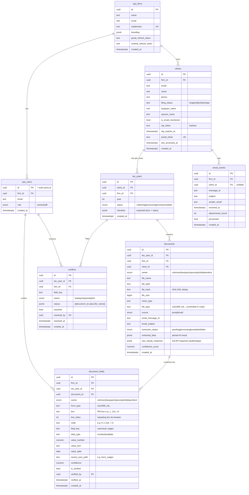

# Database Schema — Before Tax

Multi-tenant tax document intake platform. Every table carries `firm_id` and is
protected by Row Level Security (RLS) so a CPA firm can only ever see its own data.

## Data hierarchy

```
Firm → Client (报税户/return) → TaxYear (一年) → Document (文件) → DocumentField (拆出的字段)
```

`owner` (taxpayer / spouse) is a dimension on `documents` and `document_fields`,
not a separate client.

## End-to-end flow

```
Upload → AI classify → AI extract → CPA review → conflict detection → summary → CSV / ProConnect export
```

---

## Entity Relationship Diagram



---

## Table reference

Legend: **existing** = migrations 001/003 · **new** = added for extraction (migration 005)

### cpa_firms
| Column | Type | Notes |
|--------|------|-------|
| id | uuid PK | |
| name | text | Firm name |
| email | text | |
| subdomain | text UNIQUE | |
| branding | jsonb | logo / primary color |
| gmail_refresh_token | text | Email monitoring |
| outlook_refresh_token | text | |
| created_at | timestamptz | |

### cpa_users
| Column | Type | Notes |
|--------|------|-------|
| id | uuid PK | = `auth.users.id` |
| firm_id | uuid FK → cpa_firms | |
| email | text | |
| role | enum | `owner` \| `staff` |
| created_at | timestamptz | |

### clients
A client = one tax household / return.

| Column | Type | Notes |
|--------|------|-------|
| id | uuid PK | |
| firm_id | uuid FK | |
| email | text | UNIQUE(firm_id, email) |
| name | text | |
| phone | text | |
| **filing_status** | text | single\|mfj\|mfs\|hoh\|qw |
| **taxpayer_name** | text | Primary taxpayer |
| **spouse_name** | text | Spouse (MFJ) |
| is_email_monitored | bool | |
| otp_token | text | hashed OTP |
| otp_expires_at | timestamptz | |
| portal_token | text UNIQUE | portal link token |
| last_accessed_at | timestamptz | |
| created_at | timestamptz | |

### tax_years
| Column | Type | Notes |
|--------|------|-------|
| id | uuid PK | |
| client_id | uuid FK | |
| firm_id | uuid FK | |
| year | int | UNIQUE(client_id, year) |
| status | enum | collecting\|processing\|review\|complete |
| **checklist** | jsonb | `[{type, status}]` — drives completion % and missing-doc detection |
| created_at | timestamptz | |

### documents
| Column | Type | Notes |
|--------|------|-------|
| id | uuid PK | |
| tax_year_id | uuid FK | |
| firm_id | uuid FK | |
| client_id | uuid FK | |
| **owner** | enum | unknown\|taxpayer\|spouse\|joint\|dependent · DEFAULT unknown |
| file_name | text | |
| file_path | text | Storage path |
| **file_hash** | text | SHA-256 of file, dedup |
| file_size | bigint | |
| mime_type | text | |
| file_type | **text** | canonical value controlled in code (was enum) |
| source | enum | portal\|email |
| email_message_id | text | |
| email_subject | text | |
| extraction_status | enum | pending\|processing\|complete\|failed |
| extracted_data | jsonb | parsed AI result (immutable snapshot) |
| raw_claude_response | jsonb | full API response — audit & prompt replay |
| confidence_score | numeric(3,2) | document-level |
| created_at | timestamptz | |

Index: `documents(tax_year_id, file_hash)`

### document_fields (new — extraction core)
One row per extracted line item. Holds the **effective** value (CPA edits in place;
the AI original stays in `documents.extracted_data`).

| Column | Type | Notes |
|--------|------|-------|
| id | uuid PK | |
| firm_id | uuid FK | required for RLS |
| tax_year_id | uuid FK | aggregation hot path |
| document_id | uuid FK | source file |
| owner | enum | unknown\|taxpayer\|spouse\|joint\|dependent |
| form_type | text | w2\|1099_int\|... |
| box | text | IRS box, e.g. "1", "12a", "14" |
| line_index | int | tie-breaker for repeating boxes (default 0) |
| code | text | e.g. K-1 box 14 code "A" |
| field_key | text | canonical field name, e.g. `wages` |
| data_type | text | number\|text\|date |
| value_number | numeric | effective value (one column by type) |
| value_text | text | |
| value_date | date | |
| source_json_path | text | path in AI JSON, e.g. `box1_wages` (debug) |
| confidence | numeric(3,2) | AI per-field confidence |
| is_verified | bool | CPA reviewed |
| verified_by | uuid FK → cpa_users | |
| verified_at | timestamptz | |
| created_at | timestamptz | |

Constraints & indexes:
- `UNIQUE(document_id, owner, field_key, box, line_index)` — idempotent upsert
- `document_fields(firm_id)`
- `document_fields(tax_year_id, owner, field_key)`

### conflicts
| Column | Type | Notes |
|--------|------|-------|
| id | uuid PK | |
| tax_year_id | uuid FK | |
| firm_id | uuid FK | |
| **field_key** | text | canonical field (was field_name) |
| **owner** | enum | taxpayer\|spouse\|joint — per-person conflicts |
| values | jsonb | `[{document_id, value, file_name}]` |
| resolved | bool | |
| resolved_by | uuid FK → cpa_users | |
| resolved_at | timestamptz | |
| created_at | timestamptz | |

### email_events
| Column | Type | Notes |
|--------|------|-------|
| id | uuid PK | |
| firm_id | uuid FK | |
| client_id | uuid FK | nullable |
| message_id | text | |
| subject | text | |
| sender_email | text | |
| received_at | timestamptz | |
| attachments_found | int | |
| processed | bool | |
| created_at | timestamptz | |

---

## Design rules

| Rule | Detail |
|------|--------|
| Tenant isolation | Every table has `firm_id` + RLS: `firm_id = (SELECT firm_id FROM cpa_users WHERE id = auth.uid())` |
| Raw vs effective | `documents.extracted_data` = immutable AI snapshot; `document_fields.value_*` = editable effective value |
| Owner resolution | Single-filer households auto-resolve to `taxpayer`; MFJ stays `unknown` until matched by name/SSN, then CPA-reviewed |
| Typed values | number/date stored in typed columns for direct `SUM`/compare (no casting) |
| Controlled vocab | `file_type` / `form_type` are `text` but validated against a canonical list in `lib/tax/document-types.ts` |
| Idempotent extraction | Field writes use `UPSERT` on the unique key so re-running the AI job won't duplicate |
| Storage path | `/{firm_id}/{client_id}/{year}/{uuid}_{file}` |

## Common queries

Total wages for the taxpayer in a tax year:
```sql
SELECT COALESCE(SUM(value_number), 0)
FROM document_fields
WHERE tax_year_id = :ty AND owner = 'taxpayer' AND field_key = 'wages';
```

Tax summary breakdown (per person, per field):
```sql
SELECT owner, field_key, SUM(value_number)
FROM document_fields
WHERE tax_year_id = :ty
GROUP BY owner, field_key;
```

Duplicate upload check:
```sql
SELECT id FROM documents
WHERE tax_year_id = :ty AND file_hash = :hash;
```
